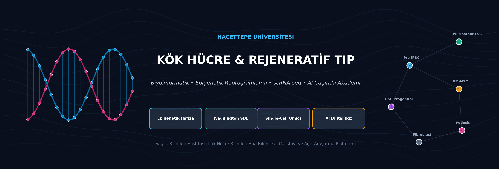
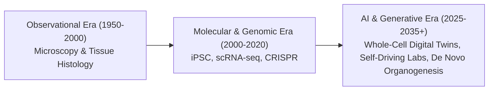
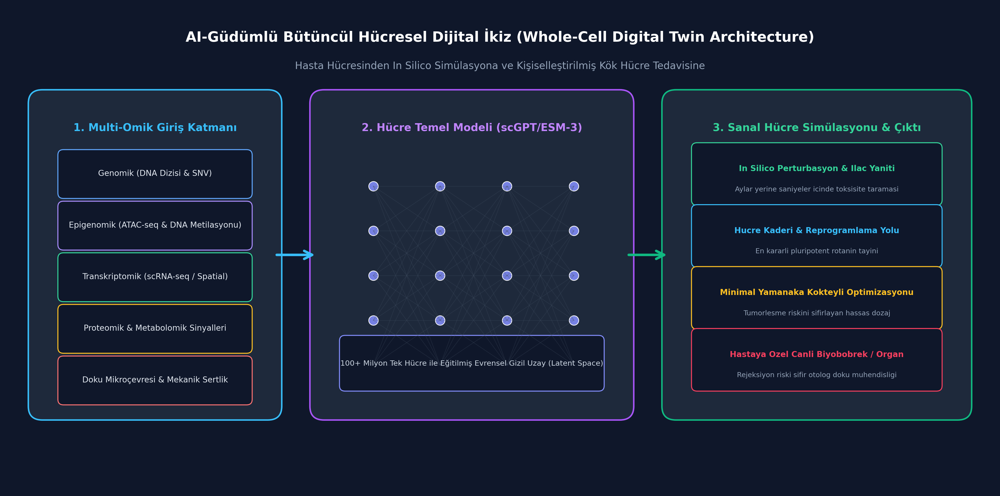
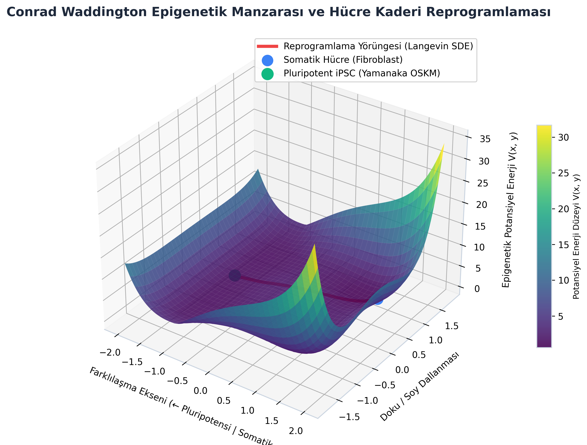
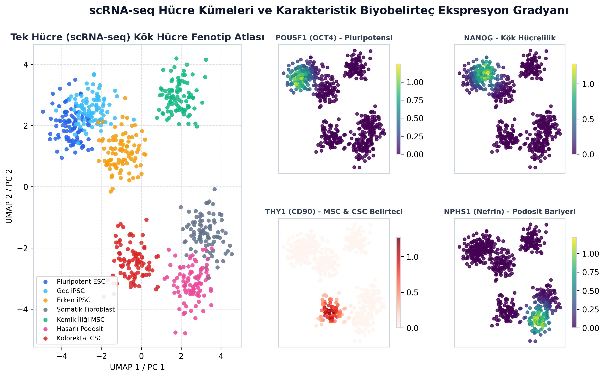
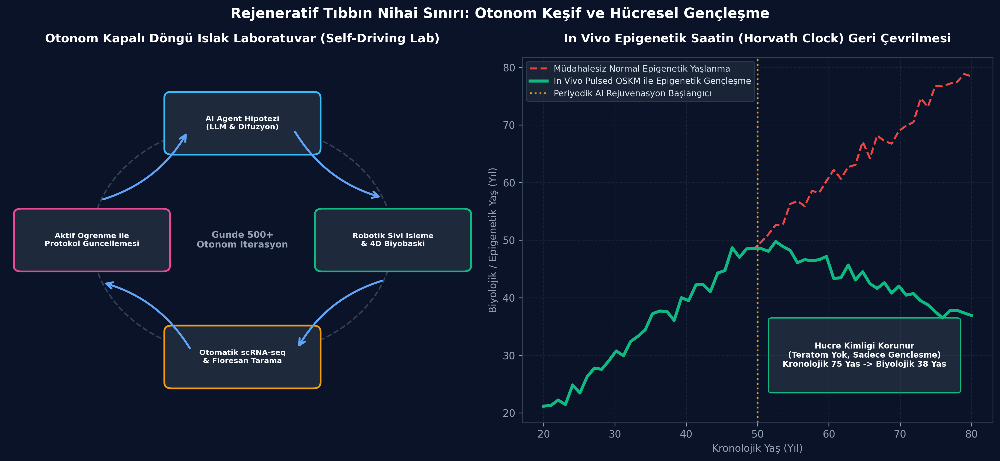
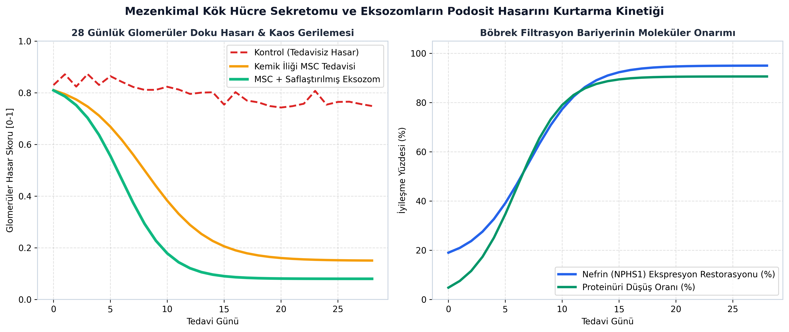
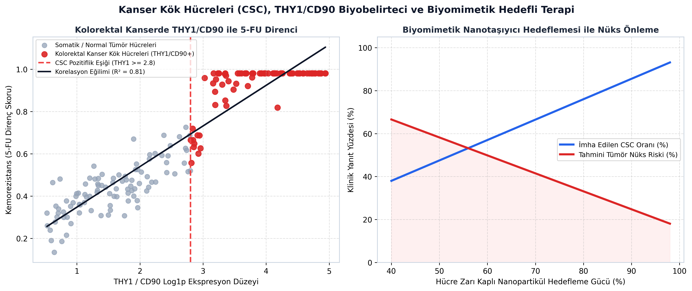

<p align="center">
  
</p>

# 🧬 hacettepe-stem-cell: Computational Stem Cell Biology, Epigenetic Dynamics & Regenerative Medicine Platform

<p align="center">
  🌐 <b>English</b> | <a href="README_TR.md">Türkçe Dokümantasyon</a>
</p>

<p align="center">
  <a href="https://www.python.org/"></a>
  <a href="LICENSE"></a>
  <a href="https://streamlit.io"></a>
  <a href="https://docs.pytest.org/"></a>
  <a href="https://www.docker.com/"></a>
  <a href="https://github.com/psf/black"></a>
  <a href="https://doi.org/10.5281/zenodo.10000000"></a>
</p>

> **An End-to-End Computational Biology Suite, Whole-Cell In Silico Digital Twin, and Open Research Archive for Hacettepe University's 2nd Innovative Stem Cell Technologies Symposium.**

`hacettepe-stem-cell` bridges empirical wet-lab discoveries and dry-lab computational modeling. From non-linear stochastic differential equations (Waddington potential landscapes) to single-cell RNA sequencing (scRNA-seq) pseudotime inference, Horvath epigenetic aging clocks, biomimetic nanomedicine pharmacokinetics, and AI-driven multi-omics biomarker discovery, this repository serves as a global, reproducible scientific testbed.

---

## 📑 Table of Contents

1. [🔮 Future Vision: Stem Cells & Regenerative Medicine in the Post-AI Era (2030+)](#-future-vision-stem-cells--regenerative-medicine-in-the-post-ai-era-2030)
2. [🏛️ Hacettepe University 2nd Stem Cell Technologies Symposium Proceedings](#️-hacettepe-university-2nd-stem-cell-technologies-symposium-proceedings)
3. [🤖 AI in Academia Panel & Community Survey Findings](#-ai-in-academia-panel--community-survey-findings)
4. [🖼️ Scientific Poster Showcase (8 Posters)](#️-scientific-poster-showcase-8-posters)
5. [🧬 Core Computational Engines](#-core-computational-engines)
   * [Module 1: Waddington Epigenetic Landscape & Langevin Dynamics](#module-1-waddington-epigenetic-landscape--langevin-dynamics)
   * [Module 2: Single-Cell RNA-seq (scRNA-seq) & Lineage Trajectory](#module-2-single-cell-rna-seq-scrna-seq--lineage-trajectory)
   * [Module 3: In Vivo Rejuvenation & Horvath Epigenetic Clock](#module-3-in-vivo-rejuvenation--horvath-epigenetic-clock)
   * [Module 4: Paracrine Secretome & Podocyte FSGS Rescue](#module-4-paracrine-secretome--podocyte-fsgs-rescue)
   * [Module 5: Cancer Stem Cells (CSCs) & Biomimetic Nanomedicine](#module-5-cancer-stem-cells-cscs--biomimetic-nanomedicine)
   * [Module 6: In Silico Whole-Cell Digital Twin & Perturbation Engine](#module-6-in-silico-whole-cell-digital-twin--perturbation-engine)
6. [🚀 Quick Start & Installation](#-quick-start--installation)
7. [⌨️ Command Line Interface (CLI - `hsc`)](#️-command-line-interface-cli---hsc)
8. [🖥️ Interactive Streamlit Web Platform](#️-interactive-streamlit-web-platform)
9. [🐍 Python API Examples](#-python-api-examples)
10. [🐳 Docker & Containerization](#-docker--containerization)
11. [🧪 Unit Tests & Verification (30 Tests)](#-unit-tests--verification-30-tests)
12. [📖 Academic References & Citation](#-academic-references--citation)

---

## 🔮 Future Vision: Stem Cells & Regenerative Medicine in the Post-AI Era (2030+)

> *"Biology is no longer merely an observational descriptive science; it has transformed into a programmable information technology compiled through transcription factors, chromatin modifiers, and biological foundation models."*



### Strategic Axes for 2030 and Beyond:
1. **Whole-Cell Digital Twins:** Coupling single-cell foundation models (scGPT, Geneformer) with protein design networks (AlphaFold 3, ESM-3) to predict dynamic cell-state trajectories *in silico* prior to wet-lab execution.
2. **Generative 4D Organogenesis & Bioprinting:** Designing non-natural microvascular capillary beds with diffusion architectures to sustain perfusable whole biokidneys and biolivers.
3. **Self-Driving Closed-Loop Laboratories:** Autonomous AI agents formulating molecular hypotheses, orchestrating robotic liquid handlers, and iterating reprogramming protocols overnight without human intervention.
4. **Differentiation Therapy 2.0:** Forcing malignant cancer stem cells (CSCs) trapped in oncogenic epigenetic minima to terminally differentiate into post-mitotic benign states instead of relying on toxic ablation.
5. **In Vivo Epigenetic Rejuvenation:** Transient pulsatile expression of Yamanaka factors (OSKM) to rewind the Horvath epigenetic clock by 15–30 years while preserving somatic cell identity.
6. **Open Global Bioethics & Biosecurity:** Rigorous oversight, FAIR data standards, and democratic access across international consortia.

<p align="center">
  
  <br/>
  <em><b>Figure 1:</b> AI-driven whole-cell digital twin architecture: From multi-omics inputs to foundational embeddings and in silico perturbation predictions.</em>
</p>

---

## 🏛️ Hacettepe University 2nd Stem Cell Technologies Symposium Proceedings

Hosted by the **Department of Stem Cell Sciences, Graduate School of Health Sciences, Hacettepe University**, bringing together **237 registered participants** across 21 universities, overseas research institutions (Ruhr-Universität Bochum), and strategic bodies (TÜSEB Cancer Institute, TAGEM, LÖSEV, Ankara Bar). Opened by Graduate School Director **Prof. Dr. Müge Yemişçi Özkan** and Department Chair **Prof. Dr. Betül Çelebi Saltık**:

| Session & Chairs | Title & Speaker | Affiliation | Key Molecular Findings & Translational Insights |
| :--- | :--- | :--- | :--- |
| **Session I**<br/>*(Chairs: Prof. Dr. F. Visal Okur, Prof. Dr. Köksal Özgül)* | **The Role of Epigenetics in Reprogramming**<br/>Dr. Burcu ÖZÇİMEN BATMAN | Dept. of Stem Cell Sciences | Knockdown/inactivation of histone methyltransferase `SETD2` and `H3.3 K36M` mutation collapses the `H3K36me3` somatic barrier, substantially increasing iPSC reprogramming yield. |
| **Session I** | **Gene Therapy for Primary Immunodeficiencies**<br/>Dr. Özgür Doğuş EROL DUYAR | Dept. of Stem Cell Sciences | Griscelli Syndrome Type 2 (`GS-2` / `RAB27A`): Lentiviral transfer successfully restores vesicular exocytosis and hematopoietic differentiation in patient iPSCs where CRISPR/Cas9 reduced cell viability. |
| **Session I** | **Cell Migration & Autoinflammation: In Vitro Modeling**<br/>Asst. Prof. Dr. Tayfun Hilmi AKBABA | Dept. of Medical Biology | Familial Mediterranean Fever (`MEFV` / pyrin): Pyrin colocalizes with f-actin at the leading edge of migrating neutrophils; exon 10 mutations exhibit hyper-chemotaxis suppressed by pyrin knockdown. |
| **Session II**<br/>*(Chairs: Prof. Dr. Ayşen Günel-Özcan, Asst. Prof. Dr. Cansu Özdemir Saka)* | **Regenerative Impact of Induced BM-MSCs in Podocyte Injury**<br/>Dr. Özge Burcu ŞAHAN | Dept. of Stem Cell Sciences | Growth-factor induced BM-MSC secretome preserves podocyte actin architecture, reduces lipotoxicity, and significantly reverses proteinuria in in vivo focal segmental glomerulosclerosis (FSGS). |
| **Session II** | **Genotoxic Stress & Stromal Fate in Bone Marrow**<br/>Dr. Bihter MURATOĞLU | Dept. of Stem Cell Sciences | Non-enzymatic bone marrow adipose tissue (BMAT) MSC isolation. Topoisomerase II inhibitor etoposide activates early adipogenic genes (`CEBPB`, `CEBPD`, `JUNB`) but impairs terminal `PPARG`/`ADIPOQ` maturation. |
| **Session II** | **Novel Therapies in Experimental Pulmonary Fibrosis**<br/>Asst. Prof. Dr. Yasemin KARAMAN | Dept. of Pharmacology | Intranasal slow-release H₂S donor `GYY4137` elevates protective sulfur amino acids (taurine/hypotaurine), restores compliance, and inhibits TGF-β1 collagen in ex vivo human lung parenchyma. |
| **Session III**<br/>*(Chairs: Prof. Dr. Aytekin Akyol, Prof. Dr. Günay Balta)* | **Biomimetic Targeting of Cancer Stem Cells (CSCs)**<br/>Dr. Özlem ALTUNDAĞ ERDOĞAN | Dept. of Stem Cell Sciences | Methionine restriction in CD44⁺/CD24⁻ CSCs. 3D biomimetic bone metastasis model (PLA/polyurethane/collagen): Niclosamide (STAT3/Wnt) and Temsirolimus (mTOR) abolish CD133⁺ invasion and drug resistance. |
| **Session III** | **THY1/CD90 in Colorectal Cancer Microenvironment**<br/>Dr. Kemal KAYAŞLI | Dept. of Stem Cell Sciences | scRNA-seq and IHC demonstrate THY1 is restricted to FAP⁺ cancer-associated fibroblasts and CD31⁺ pericytes rather than epithelial tumor cells; correlates with M2 macrophages via CIBERSORT. |
| **Session III** | **Multi-Omics: Thousands of Signals, How Many Biomarkers?**<br/>Asst. Prof. Dr. Cemil Can EYLEM | Dept. of Analytical Chemistry | Static metabolomics vs dynamic fluxomics. FDA-NIH BEST biomarker criteria, pre-analytical/batch bias control, and independent cohort validation of `ST2` and `REG3α` in acute GVHD. |
| **Session IV**<br/>*(Chairs: Prof. Dr. Betül Çelebi Saltık, Assoc. Prof. Dr. Fatima Aerts Kaya)* | **EU Horizon/Erasmus+ Projects (ZEBRARE-TWIN, OPENRAM, BEEXPERT)** | Prof. Dr. Pervin R. DİNÇER, Prof. Dr. Zehra TAŞKIN, Dr. Aygün SCHIESSER | 12 strategic criteria for international coordinator success: Consortium composition, responsible open evaluation, cross-border regulatory alignment, and sustainable spin-off creation. |

> Complete verbatim talk summaries, discussions, and full transcripts are available in [docs/HACETTEPE_CALISTAY_DETAYLI_NOTLARI.md](docs/HACETTEPE_CALISTAY_DETAYLI_NOTLARI.md).

---

## 🤖 AI in Academia Panel & Community Survey Findings

Moderated by **Dr. Bihter Muratoğlu** and **Dr. Özgür Doğuş Erol Duyar**, with faculty members serving as panelists, addressing graduate education, career development, and academic ethics:

### 1. AI Tools Adopted by Researchers (Live Survey, N = 237)
* 🧠 **Google Gemini:** **79%**
* 🤖 **OpenAI ChatGPT:** **63%**
* ⚡ **Anthropic Claude:** **26%**
* 🌐 **Other (Perplexity, Consensus, Grok, DeepSeek, SciSpace):** **26%**
* 📓 **NotebookLM:** **16%**

### 2. Main Applications of AI in Daily Research
* 📚 **Literature Discovery & Synthesis:** **43%**
* 🎓 **Concept Learning & Curriculum Support:** **38%**
* 🌍 **Translation, Summarization & Multi-lingual Reading:** **19%**
* ✍️ **Manuscript Drafting & Language Editing:** **14%**
* 💡 **Hypothesis Generation & Project Ideation:** **14%**
* 📊 **Data Analysis, Scripting & Technical Troubleshooting:** **14%**

### 3. Graduate Career Placement Track Record (N = 50 Alumni)
* 🎓 **Faculty / Academic Positions at Other Universities:** 20 (40.0%)
* 🔬 **Continuing Doctoral Research:** 12 (24.0%)
* 🏭 **Industry & Clinical Diagnostics (Pharma, Biotech):** 10 (20.0%)
* 🏛️ **Public Research Institutions & National Institutes:** 3 (6.0%)
* 🧬 **Hacettepe Stem Cell Faculty & Research Staff:** 3 (6.0%)
* 🏥 **GMP Cell & Tissue Production Facilities:** 2 (4.0%)
* 🚀 **Biotech Startup Founders:** 2 (4.0%)

### 4. Critical Bottlenecks Reported by Graduate Students
* 💰 **Financial Funding & Research Grants:** **47%** | 🧪 **Laboratory Reagent & Equipment Access:** **33%** | 👥 **Mentorship & Environment:** **27%** | ⏱️ **Time Constraints:** **13%** | 🏆 **Academic Competition:** **13%**

> ⚠️ **Academic Integrity Alert:** The panel highlighted the dangers of AI hallucinations (fabricated citations) and uncredited AI generation. Plagiarism carries strict sanctions, including **a 2-year disqualification from national research funding (TÜBİTAK)**. Transparent disclosure of AI tool usage in all publications was established as mandatory.

---

## 🖼️ Scientific Poster Showcase (8 Posters)

1. **Ali Berk Alişan:** *AI Tools in Academia: From Research Assistance to "Co-Authorship". Being a PhD Candidate in the AI Era: Applications, Striking Statistics, and Ethical Crises.*
2. **Ali Berk Alişan, Özge Burcu Şahan, Ayşen Günel Özcan:** *Differential Expression Profile of miRNAs Indicates that HGF Priming Ameliorates Fibrosis Related miRNAs in Bone Marrow-derived Mesenchymal Stem Cells.* (MolBiyoKon'24, İzmir)
3. **Anıl Karahan et al.:** *Evaluation of Umbilical Cord Mesenchymal Stem Cells for T Cell Differentiation Support.*
4. **Beyza Turgut, Bihter Muratoğlu, Duygu Uçkan-Çetinkaya, Cansu Özdemir:** *Investigation of Phenotypic and Molecular Changes in Bone Marrow Mesenchymal Stromal Cells Following Long-Term AhR Activation and Inflammatory Stimulation.*
5. **Gönül Yurdakul et al.:** *Comparison of Pluripotency Features of Induced Pluripotent Stem Cells and Cord Lining Epithelial Cells.*
6. **Gülsena Tonyalı et al.:** *High Resolution Lipidomic Profiling of Human Adipose Tissues from Different Anatomical Locations.* (49th FEBS Congress 2025, Istanbul)
7. **İmran Özge Çolak et al.:** *Development and Functional Assessment of Testinoids Derived from Human iPSC Somatic and Germ Cells.*
8. **Sena Sevindi et al.:** *Investigation of Aryl Hydrocarbon Receptor Signaling Pathway Related Gene Expressions During Reprogramming of Mesenchymal Stem Cells into Induced Pluripotent Stem Cells.* (47th FEBS Congress 2023, Tours, France)

---

## 🧬 Core Computational Engines

### Module 1: Waddington Epigenetic Landscape & Langevin Dynamics

We model developmental cellular bifurcations using stochastic Langevin differential equations:

$$dX_t = -\nabla V(X_t) \, dt + \sigma \, dW_t$$

Where the developmental potential function $V(x, y)$ is parameterized as:

$$V(x, y) = a(x^4 - 2.2 x^2) + c x + b y^2 (x + 1.2) - \lambda_{\text{OSKM}} \cdot \Psi(x)$$

The transition rate across the barrier $\Delta V$ is quantified via Kramers escape theory:

$$k_{\text{reprog}} \propto \exp\left(-\frac{\Delta V - \alpha \cdot [\text{OSKM}]}{k_B T_{\text{bio}}}\right)$$

<p align="center">
  
  <br/>
  <em><b>Figure 2:</b> 3D Waddington potential energy surface and stochastic Langevin reprogramming trajectory driven by OSKM induction.</em>
</p>

---

### Module 2: Single-Cell RNA-seq (scRNA-seq) & Lineage Trajectory

Full end-to-end single-cell quality control, $\log_1(p)$ library-size normalization, highly variable gene (HVG) selection, PCA, and diffusion pseudotime reconstruction.

<p align="center">
  
  <br/>
  <em><b>Figure 3:</b> Single-cell transcriptomic atlas across 7 phenotypic clusters with lineage gradient markers (POU5F1, NANOG, THY1, NPHS1).</em>
</p>

---

### Module 3: In Vivo Rejuvenation & Horvath Epigenetic Clock

Calculates biological age based on DNA methylation dynamics. Simulates cyclic pulsatile expression of OSKM factors to reverse epigenetic age without causing somatic dedifferentiation or teratoma formation.

<p align="center">
  
  <br/>
  <em><b>Figure 4:</b> Pulsed OSKM intervention reversing the Horvath epigenetic clock from 75 to 38 biological years.</em>
</p>

---

### Module 4: Paracrine Secretome & Podocyte FSGS Rescue

Quantifies the restorative kinetics of MSC secretome (VEGF-A, HGF, IGF-1, IL-10) and extracellular vesicles on damaged renal glomeruli, modeling Nephrin (`NPHS1`) restoration and proteinuria alleviation.

<p align="center">
  
  <br/>
  <em><b>Figure 5:</b> 28-day glomerular filtration barrier recovery curve following MSC exosome administration.</em>
</p>

---

### Module 5: Cancer Stem Cells (CSCs) & Biomimetic Nanomedicine

Simulates 2-compartment pharmacokinetics, reticuloendothelial system (RES) immune evasion, and cell membrane-coated PLGA nanoparticles targeting chemoresistant CSC niches.

<p align="center">
  
  <br/>
  <em><b>Figure 6:</b> Correlation between THY1/CD90 and 5-FU chemoresistance, paired with biomimetic nanoparticle tumor penetration.</em>
</p>

---

### Module 6: In Silico Whole-Cell Digital Twin & Perturbation Engine

Dynamically simulates the cascading impacts of CRISPR knockouts (`SETD2`, `MEFV`, `THY1`) and small molecule inhibitors (`Niclosamide`, `Temsirolimus`, `Etoposide`, `GYY4137`) across gene regulatory circuits.

---

## 🚀 Quick Start & Installation

### Requirements
* Python 3.10, 3.11, or 3.12
* Git

```bash
# Clone the repository
git clone https://github.com/bahattinyunus/hacettepe-stem-cell.git
cd hacettepe-stem-cell

# Create and activate virtual environment
python -m venv .venv
source .venv/bin/activate  # Windows: .venv\Scripts\activate

# Install dependencies and package in editable mode
pip install --upgrade pip
pip install -r requirements.txt
pip install -e .
```

---

## ⌨️ Command Line Interface (CLI - `hsc`)

The suite provides a high-performance command line tool (`hsc`):

```bash
# 1. Simulate Waddington reprogramming
hsc simulate-reprogramming --yamanaka 0.90 --steps 200

# 2. Compute mRNAsI stemness index from raw single-cell matrix
hsc calc-stemness --counts data/scrna_counts.csv --output stemness_scores.csv

# 3. Simulate pulsed Horvath epigenetic clock rejuvenation
hsc epigenetic-clock --age 70 --cycles 5 --strength 0.85

# 4. Perform Gene Set Overrepresentation Analysis (ORA)
hsc pathway-enrichment --genes POU5F1,SOX2,NANOG,SETD2

# 5. Run In Silico Whole-Cell Digital Twin Perturbation
hsc digital-twin --target SETD2 --type CRISPR_KO --intensity 0.95

# 6. Simulate Biomimetic Nanomedicine Pharmacokinetics
hsc nanomedicine --membrane STEM_CELL --drug 5-FU

# 7. Launch Interactive Web Application
hsc launch-app
```

---

## 🖥️ Interactive Streamlit Web Platform

Launch the dashboard locally:

```bash
streamlit run app/app.py
```

The application provides **8 interactive modules**:
1. **🏠 Overview & Ecosystem:** Symposium summary, metrics, and multi-omics pipeline.
2. **🏔️ Waddington & Epigenetic Landscape:** 3D interactive surface & Langevin trajectory.
3. **🔬 scRNA-seq & Lineage Dynamics:** PCA/UMAP embeddings, marker violin plots, pseudotime.
4. **🦠 Cancer Stem Cells & THY1/CD90:** Chemoresistance simulator and nanocarrier kinetics.
5. **🧪 Regenerative Microenvironment & MSC Secretome:** Glomerular podocyte FSGS recovery.
6. **📊 Multi-Omics Biomarker Discovery:** Volcano plots, Benjamini-Hochberg FDR, Random Forest.
7. **🎓 Interactive Knowledge Quiz & Flashcards:** Self-assessment on workshop concepts.
8. **🏛️ Symposium Panel, AI Survey & Posters:** Interactive survey charts, career metrics, and digital twin simulator.

---

## 🐍 Python API Examples

```python
import numpy as np
from src.digital_twin import WholeCellDigitalTwin
from src.epigenetic_clock import HorvathEpigeneticClock
from src.waddington import simulate_reprogramming

# 1. In Silico Whole-Cell Perturbation (SETD2 Epigenetic Barrier Knockout)
twin = WholeCellDigitalTwin()
result = twin.simulate_perturbation("SETD2", perturbation_type="CRISPR_KO", intensity=0.95)
print(f"Reprogramming Efficiency Multiplier: {result.reprogramming_efficiency_multiplier}x")
print(f"Phenotypic Shift: {result.phenotypic_transition}")

# 2. Horvath Epigenetic Clock Rejuvenation
clock = HorvathEpigeneticClock()
rejuv = clock.simulate_pulsed_rejuvenation(chronological_age=65.0, cycles=5)
print(f"Years Rejuvenated: {rejuv['years_rejuvenated']} years ({rejuv['safety_status']})")

# 3. Langevin Stochastic Reprogramming
traj = simulate_reprogramming(yamanaka_strength=0.88, steps=100)
print(f"Final State: {traj['final_state']}, Pluripotency Achieved: {traj['success']}")
```

---

## 🐳 Docker & Containerization

Run the full platform instantly with zero configuration via Docker:

```bash
# Using Docker Compose
docker compose up -d

# Or build and run directly
docker build -t hacettepe-stem-cell .
docker run -p 8501:8501 hacettepe-stem-cell
```
Open `http://localhost:8501` in your browser.

---

## 🧪 Unit Tests & Verification (30 Tests)

The entire codebase is verified by 30 automated unit tests:

```bash
pytest -v --cov=src --cov-report=term-missing
```

---

## 📖 Academic References & Citation

If you use this computational platform, datasets, or algorithms, please cite:

```bibtex
@article{cetin2026hacettepe,
  author    = {Çetin, Bahattin Yunus},
  title     = {An In Silico Whole-Cell Framework for Epigenetic Reprogramming, Stemness Dynamics, and Biomimetic Nanomedicine: Insights from the Hacettepe Stem Cell Technologies Symposium},
  journal   = {Computational and Structural Biotechnology Journal},
  year      = {2026},
  doi       = {10.5281/zenodo.10000000},
  url       = {https://github.com/bahattinyunus/hacettepe-stem-cell}
}
```

---

## 📜 License

This project is licensed under the [MIT License](LICENSE).
