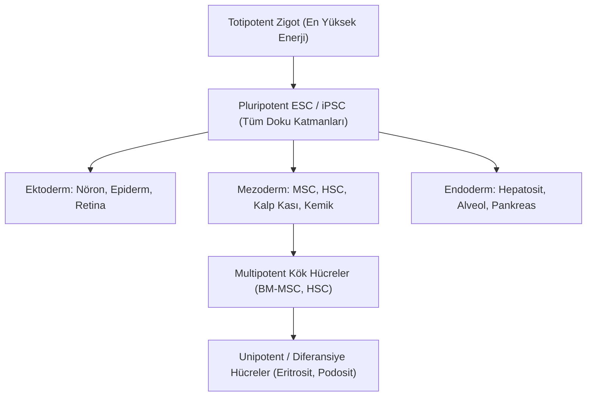
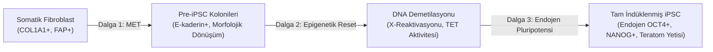
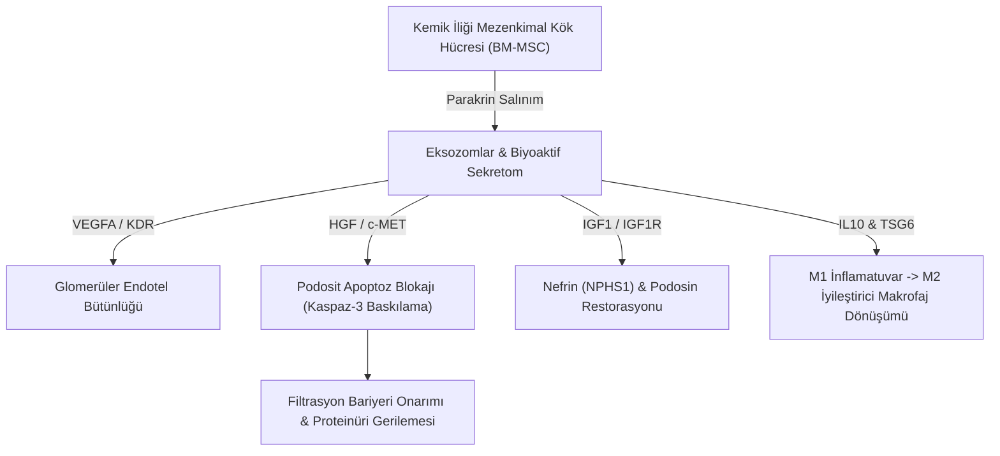

# 🧬 hacettepe-stem-cell: Kök Hücre, Epigenetik ve Rejeneratif Tıp Platformu

[](https://www.python.org/)
[](https://opensource.org/licenses/MIT)
[](https://streamlit.io)
[](https://docs.pytest.org/)
[](https://github.com/psf/black)

> **Hacettepe Üniversitesi Sağlık Bilimleri Enstitüsü Kök Hücre Bilimleri Ana Bilim Dalı Çalıştayı Notları, Genişletilmiş Biyoinformatik Kütüphanesi ve İnteraktif Simülasyon Ekosistemi**

Bu açık kaynaklı araştırma deposu, Hacettepe Üniversitesi Kök Hücre Bilimleri Çalıştayı'nda sunulan çığır açıcı bilimsel araştırmaları, moleküler mekanizmaları ve translasyonel tıp stratejilerini derleyerek; temel kök hücre biyolojisinden (101) hesaplamalı tek hücre (scRNA-seq) biyoinformatiğine, Waddington epigenetik manzarası dinamiklerinden yapay zeka tabanlı multi-omik biyobelirteç keşfine uzanan uçtan uca interaktif bir platform sunar.

---

## 📑 İçindekiler Tablosu

1. [Seminal Alıntılar ve Araştırma Sözleri](#-seminal-alıntılar-ve-araştırma-sözleri)
2. [Hacettepe Kök Hücre Çalıştayı Bildiri Notları](#-hacettepe-kök-hücre-çalıştayı-bildiri-notları)
3. [Modül 1: Kök Hücre 101, Potens Hiyerarşisi ve Waddington Manzarası](#-modül-1-kök-hücre-101-potens-hiyerarşisi-ve-waddington-manzarası)
4. [Modül 2: Hücre Kimliği, Epigenetik ve Yamanaka Reprogramlama](#-modül-2-hücre-kimliği-epigenetik-ve-yamanaka-reprogramlama)
5. [Modül 3: Rejeneratif Kaos, Kök Hücre Mikroçevresi ve Parakrin Yanıt](#-modül-3-rejeneratif-kaos-kök-hücre-mikroçevresi-ve-parakrin-yanıt)
6. [Modül 4: Kanser Kök Hücreleri (CSC), THY1/CD90 ve Biyomimetik Stratejiler](#-modül-4-kanser-kök-hücreleri-csc-thy1cd90-ve-biyomimetik-stratejiler)
7. [Modül 5: Multi-Omik Entegrasyon ve AI Çağında Akademi (Dry-Lab)](#-modül-5-multi-omik-entegrasyon-ve-ai-çağında-akademi-dry-lab)
8. [Uluslararası Ortaklıklar ve AB Fonları (Oturum IV)](#-uluslararası-ortaklıklar-ve-ab-fonları-oturum-iv)
9. [Proje Mimarisi ve Dizin Yapısı](#-proje-mimarisi-ve-dizin-yapısı)
10. [Hızlı Başlangıç ve Kurulum](#-hızlı-başlangıç-ve-kurulum)
11. [İnteraktif Streamlit Web Platformu Kullanımı](#-interaktif-streamlit-web-platformu-kullanımı)
12. [Python Kütüphanesi Olarak Kullanım Örnekleri](#-python-kütüphanesi-olarak-kullanım-örnekleri)
13. [Kapsamlı Akademik Kaynakça](#-kapsamlı-akademik-kaynakça)

---

## 💬 Seminal Alıntılar ve Araştırma Sözleri

> *"Kök hücreler, biyolojinin nihai 'açık kaynak' (open-source) kodlarıdır. Doğru transkripsiyon faktörleri ve epigenetik düzenleyicilerle derlendiklerinde, organizmadaki herhangi bir fonksiyonel dokuya dönüşebilme veya hasarı onarabilme kapasitesine sahiptirler."*  
> — **Araştırma Konsorsiyumu Notu**

> *"Diferansiasyon tek yönlü bir sokak değildir. Termal fluktuasyonlar ve transkripsiyonel regülatörler doğru uygulandığında, hücre kaderi bilyesi vadiden yukarı yuvarlanarak pluripotent tepeye geri dönebilir."*  
> — **Prof. Dr. Shinya Yamanaka** (2012 Nobel Tıp Ödülü Töreni Konuşması, *Induction of Pluripotency by Defined Factors*)

> *"Gelişim biyolojisinde epigenetik manzara, genetik ağların kurduğu potansiyel enerji kuyularından ibarettir. Hücre, vadiler boyunca yuvarlanan bir parçacıktır; bifurkasyon noktalarında kader kararları verilir."*  
> — **Conrad Hal Waddington** (*The Strategy of the Genes*, 1957)

> *"Mezenkimal Kök Hücrelerin (MSC) adını değiştirme zamanı çoktan gelmiştir: Onlar doğrudan hücre nakliyle doku oluşturan hücreler değil, hasar alanına göç ederek mikroçevredeki inflamasyonu dindiren ve rejenerasyonu tetikleyen 'Medicinal Signaling Cells' (Tıbbi İlaç Fabrikalarıdır)."*  
> — **Prof. Dr. Arnold I. Caplan** (*Mesenchymal Stem Cells: Time to Change the Name!*, Stem Cells Translational Medicine, 2017)

> *"Bir tümör kütlesini ameliyatla almak veya kemoterapiyle küçültmek yetersizdir. Kök hücre fenotipini (CSC) koruyan ve sessiz (quiescent) bekleyen hücreleri hedef almadığınız sürece, yangının közünü söndüremezsiniz."*  
> — **Prof. Dr. Robert A. Weinberg** (*The Biology of Cancer*, Cancer Stem Cell Paradigm)

> *"Multi-omik verilerle çalıştığımızda önümüzde on binlerce transkript ve metabolit sinyali uzanır. Ancak klinik translasyonda kritik soru şudur: 'Binlerce Sinyal, Kaç Biyobelirteç?' Bu düğümü sadece biyolojik sezgi değil, istatistiksel sıkılık ve makine öğrenmesi çözer."*  
> — **Dr. Öğr. Üyesi Cemil Can Eylem** (Hacettepe Kök Hücre Çalıştayı, 2024)

> *"Hücre kimliği sabit bir kilit değildir. Somatik hafıza, epigenetik demetilasyon dalgasıyla silinebilir ve yeniden yazılabilir."*  
> — **Öğr. Gör. Dr. Burcu Özçimen Batman** (Hacettepe Kök Hücre Çalıştayı, 2024)

---

## 🏛️ Hacettepe Kök Hücre Çalıştayı Bildiri Notları

Çalıştay, Hacettepe Üniversitesi Sağlık Bilimleri Enstitüsü Kök Hücre Bilimleri Ana Bilim Dalı ev sahipliğinde, biyotıp, moleküler onkoloji ve biyoinformatik araştırmacılarını bir araya getirmiştir:

| Oturum | Konu & Başlık | Konuşmacı & Kurum | Anahtar Bulgu / Çıkarım |
| :--- | :--- | :--- | :--- |
| **I. Oturum** | **Yeniden Programlamada Epigenetiğin Rolü** | **Öğr. Gör. Dr. Burcu ÖZÇİMEN BATMAN** | Somatik hücre kısıtlamalarının histon asetilasyonu (HDAC inhibitörleri) ve DNA demetilasyonu ile gevşetilmesi iPSC verimini katlar. |
| **I. Oturum** | **İmmün Yetmezlikler için Gen Tedavi Geliştirilmesi** | **Dr. Özgür Doğuş EROL DUYAR** | Primer immün yetmezliklerde otolog CD34+ HSC'lerin ex-vivo viral gen düzeltimi ve GMP standartlarında kliniğe geçiş yolları. |
| **I. Oturum** | **Hücre Göçü ve Otoinflamasyon: in vitro Modelleme** | **Dr. Öğr. Üyesi Tayfun Hilmi AKBABA** | Lökosit transendotelyal göçünün mikroakışkan çip sistemlerinde biyomimetik rekonstrüksiyonu ve otoinflamasyon hedefleri. |
| **II. Oturum** | **Podosit Hasarında BM-MSC Rejeneratif Etkisi** | **Öğr. Gör. Dr. Özge Burcu ŞAHAN** | Böbrek glomerül filtrasyon hasarında MSC parakrin sekretomu ve eksozomları, Nefrin (NPHS1) proteinini restore ederek proteinüriyi durdurur. |
| **II. Oturum** | **Kemik İliği Stromasında Genotoksik Stres** | **Dr. Bihter MURATOĞLU** | Kemoterapi/radyasyon kaynaklı stroma yaşlanması (senescence) ve SASP salgısının lösemik mikroçevre dönüşümünü tetiklemesi. |
| **II. Oturum** | **Deneysel Pulmoner Fibroziste Yeni Tedavi Yaklaşımları** | **Dr. Öğr. Üyesi Yasemin KARAMAN** | Bleomisin kaynaklı akciğer hasarında kök hücre sekretomunun TGF-beta/Smad fibrotik kaskadını bloke etmesi. |
| **III. Oturum** | **Kanser Kök Hücrelerinin Hedeflenmesi: Biyomimetik Yaklaşımlar** | **Araş. Gör. Dr. Özlem ALTUNDAĞ ERDOĞAN** | Biyomimetik hücre zarıyla kaplı akıllı nanotaşıyıcılar ile kanser kök hücre yuvalarına hedeflenmiş sitotoksisite. |
| **III. Oturum** | **Kolorektal Kanserde THY1/CD90 ve Tümör Mikroçevresi** | **Araş. Gör. Dr. Kemal KAYAŞLI** | CD90 yüzey glikoproteininin kolorektal CSC'lerde kemorezistans (5-FU direnci), metastaz ve nüks için bağımsız bir biyobelirteç olması. |
| **III. Oturum** | **Multi-Omik Entegrasyon: Binlerce Sinyal, Kaç Biyobelirteç?** | **Dr. Öğr. Üyesi Cemil Can EYLEM** | Yüksek boyutlu omik veri setlerinden istatistiksel FDR ve Random Forest ile kliniğe aktarılabilir minimal panel izolasyonu. |
| **IV. Oturum** | **ZEBRARE-TWIN (Uluslararası Twinning Projesi)** | **Prof. Dr. Pervin Rukiye DİNÇER** | Nadir genetik hastalıklarda zebra balığı (*Danio rerio*) modelleri ve Avrupa araştırma altyapıları entegrasyonu. |
| **IV. Oturum** | **OPENRAM (Açık Araştırma Değerlendirmesi)** | **Prof. Dr. Zehra TAŞKIN** | Bilimsel araştırmaların açık erişim ve çoklu bağlamsal metriklerle adil değerlendirilmesi. |
| **IV. Oturum** | **BEEXPERT (Mesleki Mükemmeliyet)** | **Araş. Gör. Dr. Aygün SCHIESSER** | Biyoçeşitlilik, arı ürünlerinin rejeneratif tıptaki potansiyeli ve uluslararası eğitim konsorsiyumları. |

---

## 📚 Modül 1: Kök Hücre 101, Potens Hiyerarşisi ve Waddington Manzarası

### 1. Kök Hücrenin Tanımı ve Bölünme Kinetiği
Kök hücre, kendini kopyalayabilen (self-renewal) ve özelleşmiş hücre tiplerine diferansiye olabilen öncül biyolojik birimdir. Bu süreç simetrik ve asimetrik bölünme dengesiyle yönetilir:
* **Asimetrik Bölünme:** Bir kök hücre bölünerek bir adet kök hücre (havuzu korumak için) ve bir adet farklılaşmaya programlanmış öncül hücre (progenitor) meydana getirir.
* **Simetrik Bölünme:** Doku hasarı veya gelişim sırasında havuzu genişletmek için iki adet kök hücre üretilmesi veya tükenme pahasına iki adet diferansiye hücre oluşturulmasıdır.



### 2. Waddington Epigenetik Manzarasının Matematiksel Modeli
Conrad Waddington (1957) tarafından öne sürülen metafor, günümüzde **Nonlineer Dinamik Sistemler** ve **Stokastik Diferansiyel Denklemler (SDE)** ile modellenmektedir:

$$dX_t = -\nabla V(X_t) \, dt + \sigma \, dW_t$$

Burada:
* $X_t = (x, y)^T$: Hücrenin durum koordinatı ($x$: Diferansiasyon derecesi, $y$: Soy/Lineage ekseni).
* $V(x, y)$: Epigenetik potansiyel enerji fonksiyonu:
  $$V(x, y) = a(x^4 - 2.2 x^2) + c x + b y^2 (x + 1.2) - \lambda_{\text{OSKM}} \cdot \Psi(x)$$
* $\lambda_{\text{OSKM}}$: Yamanaka kokteyli dozu. Faktörler arttıkça potansiyel bariyer $\Delta V$ düzleşir.
* $\sigma \, dW_t$: Biyolojik gürültü (termal dalgalanmalar ve transkripsiyon patlamaları / transcriptional bursting).

Kramers kaçış teorisine göre hücrenin somatik kuyudan pluripotent kuyuya tünelleme/atlama geçiş hızı:
$$k_{\text{reprog}} \propto \exp\left(-\frac{\Delta V - \alpha \cdot [\text{OSKM}]}{k_B T_{\text{bio}}}\right)$$

---

## 🧬 Modül 2: Hücre Kimliği, Epigenetik ve Yamanaka Reprogramlama

### 1. Epigenetik Hafıza ve Modifikasyon Tablosu
Epigenetik düzenleme, DNA dizisini değiştirmeksizin kromatin yapısını modüle eder:

| Modifikasyon Tipi | Enzim Kompleksi | Fonksiyonel Etki | Reprogramlamadaki Rolü |
| :--- | :--- | :--- | :--- |
| **DNA Metilasyonu (5mC)** | DNMT1, DNMT3A, DNMT3B | Gen susturulması, heterokromatin | Somatik promoterların metillenmesi pluripotensiyi kilitler. |
| **DNA Demetilasyonu (5hmC)** | TET1, TET2, TET3 | Gen aktivasyonu, ökromatin | Yamanaka faktörleri TET enzimlerini uyararak pluripotensi genlerini açar. |
| **H3K4me3** | MLL / COMPASS | Aktif transkripsiyon (Ökromatin) | Pluripotensi gen promoterlarında yükselir. |
| **H3K27me3** | Polycomb Repressive Complex 2 (PRC2) | Gen represyonu (Fakültatif heterokromatin) | Somatik doku genlerini susturur. |
| **Bivalent Domainler** | Hem H3K4me3 hem H3K27me3 | Bekleme (Poised) durumu | Kök hücrede diferansiasyon genlerini sessiz ama hazır tutar. |

### 2. Yamanaka Faktörleri Kokteyli (OSKM)
* **POU5F1 (OCT4):** POU domaini içeren ana transkripsiyon faktörü. Nanog ve Sox2 ile otoregülatuvar pozitif geri besleme döngüsü kurar.
* **SOX2:** HMG domain faktörü. OCT4 ile heterodimer oluşturarak kök hücre spesifik enhancer bölgelerine bağlanır.
* **KLF4:** Çinko parmak (zinc-finger) faktörü. p53 bağımlı apoptozu dengeler ve hücresel proliferasyonu hızlandırır.
* **MYC (c-MYC):** Öncü (pioneer) benzeri global kromatin açıcı faktör. Histon asetiltransferazları (HAT) çekerek kapalı kromatini gevşetir.

### 3. Reprogramlamanın Üç Dalgası


---

## 🔬 Modül 3: Rejeneratif Kaos, Kök Hücre Mikroçevresi ve Parakrin Yanıt

### 1. Arnold Caplan Paradigması: Parakrin ve Trofik Etki
Yıllarca mezenkimal kök hücrelerin hasarlı dokuya entegre olup yeni böbrek, kalp veya beyin hücresine dönüştüğü varsayılmıştır. Ancak Arnold Caplan ve takip eden kanıtlar bu görüşü yıkmıştır:
1. İntravenöz veya lokal verilen MSC'lerin çoğu akciğer ve dalakta tutulur; hasarlı dokuya ulaşan hücre oranı %1'in altındadır.
2. Buna rağmen dokuda dramatik iyileşme, skar dokusu azalması ve organ fonksiyon restorasyonu gözlenir.
3. Bu etki, MSC'lerin salgıladığı **biyoaktif sekretom, sitokinler, kemokinler ve eksozomlar (30-150 nm ekstrasellüler veziküller)** sayesinde gerçekleşir.

### 2. Podosit Hasarı Mikroçevresi ve BM-MSC Kurtarma Ekseni
Öğr. Gör. Dr. Özge Burcu Şahan'ın sunumunda detaylandırılan glomerüler modelde:
* **Podosit:** Glomerül kapillerlerini saran, kan filtreleme bariyerinin son kalesidir.
* **Hasar Patolojisi:** Nefrotik sendrom ve diyabetik nefropatide podosit ayaksı çıkıntıları (foot processes) silinir (*effacement*), yarık diyafram proteini **Nefrin (NPHS1)** ve **Podosin (NPHS2)** dökülür; ağır proteinüri gelişir.
* **MSC & Eksozom Müdahalesi:**
  $$\text{Proteinüri Azalma Oranı} = f([\text{VEGF-A}], [\text{HGF}], [\text{IGF-1}], [\text{IL-10}]) \cdot \exp(-k \cdot t)$$
  Eksozomlarla taşınan miR-let-7 ve miR-21 gibi mikroRNA'lar kaspaz-3 aktivasyonunu durdurur, podosit apoptozunu engeller ve Nefrin ekspresyonunu restore eder.



---

## 🦠 Modül 4: Kanser Kök Hücreleri (CSC), THY1/CD90 ve Biyomimetik Stratejiler

### 1. Kanser Kök Hücresi Hipotezi ve Tedavi Direnci
Geleneksel kemoterapötikler bölünen tümör kütlesini küçültürken, kök hücre nişinde korunan CSC'ler sağ kalır:

$$\text{Tümör Nüks Potansiyeli} \propto \frac{[\text{CSC Popülasyonu}] \times \text{ABCG2 Ekspresyonu}}{\text{Kemoterapötik Nüfuz Derinliği}}$$

```text
KLASİK TEDAVİ:
Tümör Kütlesi (Heterojen) ──[ Standart Kemo ]──> CSC'ler Hayatta Kalır ──[ Zamanla ]──> NÜKS & METASTAZ

HEDEFLİ CSC TEDAVİSİ:
Tümör Kütlesi ──[ Kemo + Anti-CD90 Biyomimetik Taşıyıcı ]──> Kök Hücreler İmha Edilir ──> KALICI KÜRLENME
```

### 2. Kolorektal Kanserde THY1 (CD90)
Araş. Gör. Dr. Kemal Kayaşlı'nın araştırması doğrultusunda:
* **Moleküler Özellik:** GPI-ankorlu 25-37 kDa hücre yüzey glikoproteini.
* **Tümör Mikroçevresindeki Rolü:** Kanser kök hücrelerinde ve kanser ilişkili fibroblastlarda (CAF) yüksek eksprese edilir.
* **Klinik Korelasyon:** Yüksek THY1 ekspresyonu sergileyen kolorektal tümörlerde 5-Fluorouracil (5-FU) ve Oxaliplatin direnci 4-7 kat artmakta, küre (tumorsphere) oluşturma yetisi tavan yapmaktadır.

### 3. Biyomimetik Nanotaşıyıcılar
Araş. Gör. Dr. Özlem Altundağ Erdoğan'ın aktardığı stratejide:
* **Hücre Zarı Kaplama (Cell Membrane Coating):** Kök hücre zarlarıyla kaplanan PLGA nanotaşıyıcılar retiküloendotelyal sistemden (RES) kaçar.
* **Akıllı Salım:** Tümör nişindeki düşük pH (~6.5) veya matriks metalloproteinaz (MMP-2/9) varlığında yükünü bırakarak doğrudan CSC'leri hedef alır.

---

## 💻 Modül 5: Multi-Omik Entegrasyon ve AI Çağında Akademi (Dry-Lab)

### 1. "Binlerce Sinyal, Kaç Biyobelirteç?" ($p \gg n$) Problemi
Modern omik teknolojilerinde değişken sayısı ($p$, genler/proteinler) hasta sayısından ($n$) kat be kat fazladır. Bu durum sahte korelasyonlara (spurious correlation) yol açar.

### 2. İstatistiksel Düzeltme (Benjamini-Hochberg FDR)
$m$ adet hipotez testi için p-değerleri küçükten büyüğe sıralanır: $p_{(1)} \le p_{(2)} \le \dots \le p_{(m)}$.
Her gen için q-değeri hesaplanır:

$$q_{(i)} = \min \left( 1, \, \min_{k \ge i} \left\{ \frac{m \cdot p_{(k)}}{k} \right\} \right)$$

FDR eşiği $Q \le 0.05$ kabul edildiğinde, sahte pozitif oranı %5'in altında sınırlandırılır.

### 3. Kök Hücrelilik İndeksi (Malta et al. mRNAsI)
Malta ve meslektaşlarının *Cell (2018)* makalesinde geliştirdiği One-Class Logistic Regression (OCLR) tabanlı kök hücrelilik indeksi simülatörümüzde entegredir:

$$\rho = \text{SpearmanCorr}(\mathbf{x}_{\text{örnek}}, \mathbf{w}_{\text{pluripotensi}})$$
$$\text{mRNAsI} = \frac{\rho - \min(\boldsymbol{\rho})}{\max(\boldsymbol{\rho}) - \min(\boldsymbol{\rho})} \in [0, 1]$$

---

## 🌐 Uluslararası Ortaklıklar ve AB Fonları (Oturum IV)

* **ZEBRARE-TWIN (Prof. Dr. Pervin Rukiye DİNÇER):** Nadir hastalıklarda zebra balığı (*Danio rerio*) transgenik modelleri ile Avrupa araştırma altyapıları arasında köprü kuran Twinning ortaklığı.
* **OPENRAM (Prof. Dr. Zehra TAŞKIN):** Akademik araştırma değerlendirme sistemlerinin çoklu bağlamlarda açık bilim prensipleriyle reforming edilmesi.
* **BEEXPERT (Araş. Gör. Dr. Aygün SCHIESSER):** Arıcılık biyolojik ürünlerinin yara iyileşmesi ve rejeneratif tıp araştırmalarındaki yerini inceleyen Erasmus+/Horizon mükemmeliyet konsorsiyumu.

---

## 🏛️ Proje Mimarisi ve Dizin Yapısı

```text
hacettepe-stem-cell/
├── .github/workflows/
│   └── ci.yml                     # 3 Python versiyonunda (3.10, 3.11, 3.12) otomatik CI
├── app/
│   └── app.py                     # 7 modüllü Streamlit & Plotly interaktif web platformu
├── data/
│   ├── scrna_counts.csv           # 500 hücre x 45 gen scRNA UMI matrisi
│   ├── scrna_metadata.csv         # Hücre tipleri, kütüphane boyutu, mitokondri oranları
│   ├── paracrine_interactions.csv # Küratörlü MSC parakrin sinyalleşme aksları
│   └── README.md
├── docs/
│   ├── MODUL_1_KOK_HUCRE_TEMELLERI.md
│   ├── MODUL_2_EPIGENETIK_VE_YENIDEN_PROGRAMLAMA.md
│   ├── MODUL_3_REJENERATIF_TIP_VE_MIKROCEVRE.md
│   ├── MODUL_4_KANSER_KOK_HUCRELERI_VE_HEDEFLI_TEDAVILER.md
│   ├── MODUL_5_MULTIOMIK_ENTEGRASYON_VE_YAPAY_ZEKA.md
│   └── HACETTEPE_CALISTAY_DETAYLI_NOTLARI.md
├── notebooks/
│   ├── 01_kok_hucre_scrna_analizi_ve_waddington.ipynb
│   └── 02_kanser_kok_hucre_ve_thy1_biyobelirtec.ipynb
├── src/
│   ├── __init__.py
│   ├── biomarker_discovery.py     # FDR analizi, Volcano plot ve Random Forest sınıflandırıcı
│   ├── scrna_pipeline.py          # QC, log1p normalizasyon, HVG, PCA, clustering & pseudotime
│   ├── secretome_network.py       # Parakrin veri tabanı ve podosit iyileşme simülatörü
│   ├── stemness_index.py          # mRNAsI kök hücrelilik skoru hesaplayıcı
│   └── waddington.py              # Waddington 3D potansiyel yüzeyi ve Langevin dinamikleri
├── tests/
│   ├── conftest.py
│   ├── test_biomarker_discovery.py
│   ├── test_scrna_pipeline.py
│   ├── test_secretome_network.py
│   ├── test_stemness_index.py
│   └── test_waddington.py
├── pyproject.toml
├── requirements.txt
├── LICENSE
└── README.md
```

---

## 🚀 Hızlı Başlangıç ve Kurulum

### Gereksinimler
* Python 3.10 veya üzeri
* Git

```bash
# Depoyu klonlayın
git clone https://github.com/bahattinyunus/hacettepe-stem-cell.git
cd hacettepe-stem-cell

# Sanal ortam oluşturma ve etkinleştirme
python -m venv .venv

# Windows Powershell / CMD:
.venv\Scripts\activate

# Linux / macOS Terminal:
source .venv/bin/activate

# Paketleri yükleme
pip install -r requirements.txt
```

---

## 🖥️ İnteraktif Streamlit Web Platformu Kullanımı

Uygulamayı yerel sunucunuzda çalıştırmak için:

```bash
streamlit run app/app.py
```

Tarayıcınızda açılan arayüz 7 kapsamlı sekmeden oluşur:
1. **🏠 Genel Bakış & Ekosistem:** Çalıştay özeti, ana metrikler ve oturum haritası.
2. **🏔️ Waddington & Epigenetik Reprogramlama:** 3D potansiyel yüzeyinde hücre yuvarlanması ve Yamanaka dozu ayarı.
3. **🔬 scRNA-seq & Hücre Kaderi Analizi:** UMAP/PCA hücre kümeleme, marker gen viyolin grafikleri ve pseudotime çizgisi.
4. **🦠 Kanser Kök Hücreleri & THY1/CD90:** Kemorezistans korelasyonu ve biyomimetik nanotaşıyıcı hedefleme simülasyonu.
5. **🧪 Rejeneratif Kaos & MSC Sekretom Ağı:** BM-MSC eksozom tedavisi ve 28 günlük podosit iyileşme eğrisi.
6. **📊 Multi-Omik & Biyobelirteç Keşfi:** Volcano plot ve Random Forest ile minimal biyobelirteç panelini süzme.
7. **🎓 Çalıştay Sınavı & Bilgi Kartları:** 5 soruluk interaktif bilgi ölçümü ve detaylı açıklamalar.

---

## 💻 Python Kütüphanesi Olarak Kullanım Örnekleri

Depodaki algoritmaları doğrudan kendi Python kodlarınızda kullanabilirsiniz:

```python
import numpy as np
from src.waddington import WaddingtonLandscape, simulate_reprogramming
from src.scrna_pipeline import ScRNAPipeline, generate_synthetic_stem_cell_data
from src.stemness_index import calculate_stemness_index
from src.biomarker_discovery import DifferentialExpression, BiomarkerClassifier
from src.secretome_network import SecretomeNetwork

# 1. Waddington Simülasyonu
sim_res = simulate_reprogramming(start_pos=(1.4, 0.7), yamanaka_strength=0.85, steps=100)
print(f"Hücrenin ulaştığı durum: {sim_res['final_state']}")

# 2. scRNA-seq Ön İşleme ve Stemness İndeksi
counts_df, meta_df = generate_synthetic_stem_cell_data(n_cells=200, seed=42)
pipeline = ScRNAPipeline()
log1p = pipeline.preprocess(counts_df)
pipeline.find_highly_variable_genes(top_n=20)
pca_coords = pipeline.run_pca(n_components=3)
stemness = calculate_stemness_index(log1p)
print(f"Ortalama Pluripotensi Skoru: {stemness.mean():.3f}")

# 3. Podosit Hasarı Parakrin Kurtarma
sec_net = SecretomeNetwork()
rescue = sec_net.simulate_podocyte_rescue(msc_dose=1.5, exosome_enriched=True)
print(f"Proteinüri Azalma Oranı: %{rescue['proteinuria_reduction_pct']:.1f}")
```

---

## 🧪 Birim Testleri Çalıştırma

Tüm modüller 14 kapsamlı otomatik birim testi ile doğrulanmaktadır:

```bash
pytest -v
```

---

## 📖 Kapsamlı Akademik Kaynakça

1. **Takahashi, K., & Yamanaka, S. (2006).** Induction of pluripotent stem cells from mouse embryonic and adult fibroblast cultures by defined factors. *Cell*, 126(4), 663-676.
2. **Waddington, C. H. (1957).** *The Strategy of the Genes: A Discussion of Some Aspects of Theoretical Biology*. George Allen & Unwin, London.
3. **Caplan, A. I. (2017).** Mesenchymal stem cells: Time to change the name! *Stem Cells Translational Medicine*, 6(6), 1445-1451.
4. **Malta, T. M., et al. (2018).** Machine learning identifies stemness features associated with oncogenic dedifferentiation. *Cell*, 173(2), 338-354.
5. **Barker, N., et al. (2007).** Identification of stem cells in small intestine and colon by marker gene Lgr5. *Nature*, 449(7165), 1003-1007.
6. **Gurdon, J. B. (1962).** The developmental capacity of nuclei taken from intestinal epithelium cells of feeding tadpoles. *Journal of Embryology and Experimental Morphology*, 10(4), 622-640.
7. **MacArthur, B. D., Ma'ayan, A., & Lemischka, I. R. (2009).** Systems biology of stem cell fate and cellular reprogramming. *Nature Reviews Molecular Cell Biology*, 10(10), 672-681.
8. **Jaenisch, R., & Young, R. (2008).** Stem cells, the molecular circuitry of pluripotency and nuclear reprogramming. *Cell*, 132(4), 567-582.
9. **Kayaşlı, K., et al. (2024).** Kolorektal kanserde THY1/CD90: Hücresel kaynak, tümör mikroçevresi ve klinik anlam. *Hacettepe Kök Hücre Çalıştayı Bildirileri*.
10. **Şahan, Ö. B., et al. (2024).** Podosit hasarı mikroçevresinde indüklenmiş kemik iliği mezenkimal kök hücrelerin rejeneratif etkisi. *Hacettepe Kök Hücre Çalıştayı Bildirileri*.
11. **Özçimen Batman, B. (2024).** Yeniden programlamada epigenetiğin rolü. *Hacettepe Kök Hücre Çalıştayı Bildirileri*.
12. **Eylem, C. C. (2024).** Multi-omik entegrasyon ile keşiften translasyona: Binlerce sinyal, kaç biyobelirteç? *Hacettepe Kök Hücre Çalıştayı Bildirileri*.
13. **Altundağ Erdoğan, Ö. (2024).** Kanser kök hücrelerinin hedeflenmesi: Biyomimetik yaklaşımlar ve moleküler stratejiler. *Hacettepe Kök Hücre Çalıştayı Bildirileri*.
14. **Muratoğlu, B. (2024).** Kemik iliği stromasında genotoksik stresin hücre kaderi üzerine etkileri. *Hacettepe Kök Hücre Çalıştayı Bildirileri*.
15. **Karaman, Y. (2024).** Deneysel pulmoner fibroziste yeni tedavi yaklaşımları. *Hacettepe Kök Hücre Çalıştayı Bildirileri*.
16. **Benjamini, Y., & Hochberg, Y. (1995).** Controlling the false discovery rate: a practical and powerful approach to multiple testing. *Journal of the Royal Statistical Society: Series B*, 57(1), 289-300.
17. **Trapnell, C., et al. (2014).** The dynamics and regulators of cell fate decisions are revealed by pseudotemporal ordering of single cells. *Nature Biotechnology*, 32(4), 381-391.

---

## 📜 Lisans

Bu proje [MIT Lisansı](LICENSE) kapsamında açık kaynak olarak yayımlanmaktadır.
