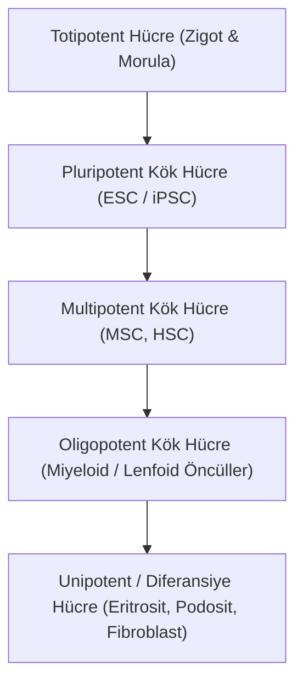

# 📚 Modül 1: Kök Hücre 101 ve Hücresel Plastisite

## 1. Giriş ve Temel Kavramlar

Kök hücreler, embriyonik gelişimden yetişkin organizmadaki doku homeostazına kadar yaşamın devamlılığını sağlayan özelleşmemiş öncül hücrelerdir. Bir hücrenin kök hücre olarak tanımlanabilmesi için iki temel biyolojik kriteri sağlaması gerekir:

1. **Kendi Kendini Yenileme (Self-Renewal):** Hücre bölünmesi sırasında farklılaşmadan, kendisiyle aynı potansiyelde en az bir yavru hücre üretebilme kapasitesi. Bu süreç simetrik veya asimetrik bölünme ile gerçekleşir.
2. **Farklılaşma Potansiyeli (Potency / Differentiation):** Uygun mikromimetik veya biyokimyasal sinyaller aldığında bir veya birden fazla özelleşmiş hücre tipine (örneğin nöron, kardiyomiyosit, hepatosit, kondrosit) dönüşebilme yeteneği.

---

## 2. Hücresel Potens Hiyerarşisi

Hücrelerin gelişimsel potansiyeli azalan bir spektrumda sınıflandırılır:

### 2.1. Totipotent Hücreler
* **Kapsam:** Döllenmiş yumurta (zigot) ve erken embriyonik bölünmelerin ilk 4-8 hücresi (morula evresi).
* **Kabiliyet:** Hem embriyonik dokuları (ektoderm, mezoderm, endoderm) hem de ekstra-embriyonik destek dokularını (plasenta, amniyon kesesi) oluşturabilen ve dolayısıyla tek başına tam bir organizma meydana getirebilen yegane hücre tipidir.

### 2.2. Pluripotent Kök Hücreler (ESC & iPSC)
* **Kapsam:** Blastokist evresindeki iç hücre kitlesinden (Inner Cell Mass - ICM) izole edilen embriyonik kök hücreler (ESC) veya somatik hücrelerden indüklenen pluripotent kök hücreler (iPSC).
* **Kabiliyet:** Üç embriyonik germ yaprağının tamamına dönüşebilir:
  * **Ektoderm:** Sinir sistemi, retina, epiderm.
  * **Mezoderm:** Kemik, kıkırdak, kas, kardiyovasküler sistem, kan hücreleri.
  * **Endoderm:** Sindirim sistemi epiteli, karaciğer, pankreas, akciğer epiteli.
* **Sınırlılık:** Trofoblast/plasenta dokusu oluşturamadıkları için tek başlarına embriyo meydana getiremezler.
* **Anahtar Belirteçler:** POU5F1 (OCT4), SOX2, NANOG, ZFP42, LIN28A.

### 2.3. Multipotent Kök Hücreler
* **Kapsam:** Yetişkin dokularda (somatik kök hücreler) hasar onarımı ve doku yenilenmesinden sorumlu hücreler.
* **Örnekler:**
  * **Hematopoietik Kök Hücreler (HSC):** Kemik iliğinde tüm kan hücresi serilerini (eritrosit, lökosit, trombosit) üretir.
  * **Mezenkimal Kök Hücreler (MSC):** Kemik (osteoblast), kıkırdak (kondrosit) ve yağ (adiposit) soylarına farklılaşabilir.
  * **Nöral Kök Hücreler (NSC):** Nöron, astrosit ve oligodendrosit üretir.

---

## 3. Conrad Waddington'ın Epigenetik Manzarası

1957 yılında evrimsel biyolog Conrad Hal Waddington tarafından öne sürülen metafor, hücre kaderinin nasıl tayin edildiğini görselleştiren en etkili kavramsal modeldir:

$$\frac{dX}{dt} = -\nabla V(X) + \sigma \xi(t)$$

* Manzaranın zirvesi (yüksek potansiyel enerji), totipotent zigotu temsil eder.
* Farklılaşma, bir bilyenin tepeden aşağıya, yerçekimi etkisiyle vadilere doğru yuvarlanması gibidir.
* Vadilerin çatallandığı noktalar, hücresel kader kararlarını (lineage bifurcation) gösterir.
* Vadi tabanları ise erişkin somatik hücrelerin kararlı minimum enerji kuyularıdır.
* Klasik Waddington görüşünde bu yuvarlanma tek yönlü kabul edilirken, modern kök hücre biyolojisi ve Yamanaka reprogramlaması bu akışın tersine çevrilebileceğini kanıtlamıştır.
