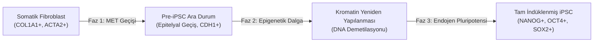

# 🧬 Modül 2: Hücre Kimliği, Epigenetik ve Yamanaka Reprogramlama

## 1. Epigenetik Mekanizmalar ve Hücresel Hafıza

> **Oturum I Araştırma Vurgusu (Öğr. Gör. Dr. Burcu ÖZÇİMEN BATMAN):**
> *"Hücre kimliği kalıcı bir kader değil; epigenetik kilitlerle korunan dinamik bir durumdur. Doğru transkripsiyon faktörleri bu kilitleri açabilir."*

Epigenetik, DNA primer diziliminde (A-T-G-C) herhangi bir değişiklik olmaksızın gen ifadesinin kalıtsal olarak düzenlenmesini sağlayan biyokimyasal mekanizmalar bütünüdür.

### 1.1. Temel Epigenetik Değişiklikler
* **DNA Metilasyonu:** CpG adacıklarındaki sitozin bazlarına metil grubu ($-\text{CH}_3$) eklenmesi (genellikle DNMT1, DNMT3A, DNMT3B enzimleri). Promoter bölgesindeki yoğun metilasyon gen susturulmasına (silencing) yol açar.
* **Histon Modifikasyonları:**
  * **Histon Asetilasyonu (HAT / HDAC):** Histon kuyruklarındaki lizin kalıntılarının asetillenmesi kromatin yapısını gevşetir (ökromatin) ve transkripsiyona izin verir.
  * **Histon Metilasyonu:**
    * $\text{H3K4me3}$: Aktif promoter belirteci.
    * $\text{H3K27me3}$: Polcomb baskılayıcı kompleks (PRC2) tarafından kurulan represif belirteç.
* **Bivalent Kromatin:** Pluripotent kök hücrelerde hem aktif ($\text{H3K4me3}$) hem de baskılayıcı ($\text{H3K27me3}$) izleri aynı anda taşıyan promoterlar. Bu sayede gelişimsel genler sessiz tutulur ancak farklılaşma sinyali geldiğinde hızla aktive edilebilir.

---

## 2. İndüklenmiş Pluripotent Kök Hücreler (iPSC)

2006 yılında Shinya Yamanaka ve Kazutoshi Takahashi, fare ve insan deri fibroblastlarını sadece 4 transkripsiyon faktörü kullanarak embriyonik kök hücre benzeri bir pluripotensi durumuna döndürmeyi başarmıştır (2012 Nobel Tıp Ödülü).

### 2.1. Yamanaka Kokteyli (OSKM)
1. **OCT4 (POU5F1):** Ana pluripotensi düzenleyicisi; hedef kök genleri aktive eder, somatik farklılaşma programlarını baskılar.
2. **SOX2:** OCT4 ile heterodimer oluşturarak kök hücre genomik erişilebilirliğini düzenler.
3. **KLF4:** Hücre döngüsünü, apoptoz direncini ve telomeraz aktivitesini uyarır.
4. **c-MYC:** Kromatin yapısını gevşeterek (global ökromatinizasyon) diğer faktörlerin DNA'ya erişimini hızlandırır.

### 2.2. Reprogramlama Fazları

1. **Erken Faz (MET - Mezenkimalden Epitelyale Geçiş):** Fibroblast benzeri hareketli morfolojinin kaybolması, E-kaderin (CDH1) artışı, stromal genlerin baskılanması.
2. **Orta Faz (Epigenetik Dalga):** DNA demetilasyonu (TET enzimleri aracılığıyla 5mC -> 5hmC dönüşümü), X kromozomu reaktivasyonu (kadın hücrelerinde).
3. **Geç Faz (Endojen Ağın Aktivasyonu):** Dışarıdan verilen viral transgenler sessizleşir; hücrenin kendi endojen *OCT4*, *NANOG* ve *SOX2* genleri daimi olarak çalışmaya başlar.

---

## 3. Reprogramlamanın Translasyonel ve Klinik Gücü

* **Hastaya Özgü Hastalık Modelleri:** Genetik hastalığı olan bireylerden alınan deri/kan hücrelerinden iPSC üretilerek nöron, böbrek veya kalp hücrelerine farklılaştırılır; in vitro hastalık mekanizmaları test edilir.
* **Kişiselleştirilmiş İlaç Tarama:** Bireyin kendi genetik arka planında ilaç toksisitesi ve etkinliği önceden taranabilir.
* **Etik Avantaj:** İnsan embriyolarının kullanımına ihtiyaç duymaksızın pluripotent hücre elde edilir.
