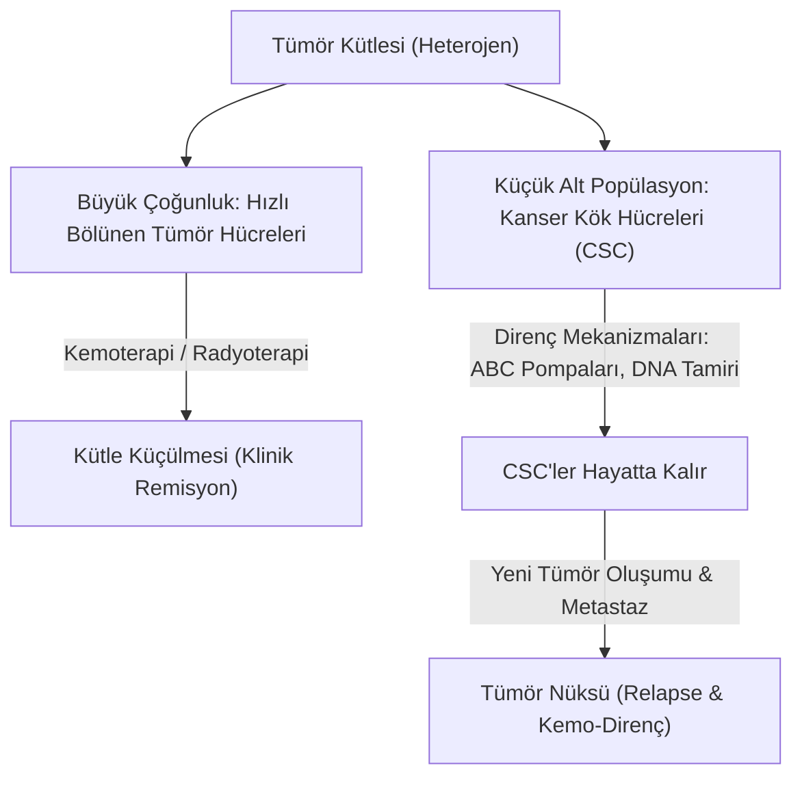

# 🦠 Modül 4: Kanser Kök Hücreleri (CSC), THY1/CD90 ve Biyomimetik Stratejiler

## 1. Kanser Kök Hücresi (CSC) Hipotezi

Geleneksel onkoloji modelinde tümör içindeki tüm hücrelerin eşit tümör başlatma potansiyeline sahip olduğu varsayılırdı (Stokastik Model). Ancak güncel moleküler onkoloji **Hiyerarşik Kök Hücre Modeli**ni doğrulamıştır:

### 1.1. CSC'lerin Kemorezistans Mekanizmaları
1. **Sakinlik (Quiescence / G0 Evresi):** Klasik kemoterapötikler (5-FU, Sisplatin, Taksol) hızla bölünen hücreleri hedefler; dinlenme evresindeki CSC'ler hasardan kaçar.
2. **Yüksek ABC Taşıyıcı Pompaları (MDR1, ABCG2):** Hücre içine giren kemoterapi ajanlarını ATP harcayarak dışarı atarlar.
3. **Güçlü DNA Hasar Yanıtı:** Genotoksik ajanların oluşturduğu çift zincir kırıklarını hızla tamir ederler (ATM/ATR, Chk1 aktivasyonu).
4. **Yüksek ALDH Aktivitesi:** Toksik reaktif oksijen türlerini ve kemoterapötik türevleri nötralize ederler.

---

## 2. Kolorektal Kanserde THY1/CD90 Biyobelirteci

> **Oturum III Vurgusu (Araş. Gör. Dr. Kemal KAYAŞLI):**
> *"Kolorektal kanser mikroçevresinde THY1 (CD90) ekspresyonu, kanser kök hücresi zenginleşmesi, invazyon ve kemoterapi direnci ile yüksek korelasyon göstermektedir. Bu hücrelerin hedeflenmesi nüksün önlenmesinde anahtardır."*

* **CD90 / THY1:** 25-37 kDa ağırlığında, GPI-bağlantılı bir hücre yüzey glikoproteinidir.
* Kolorektal kanserde hem kanser kök hücrelerinde hem de tümör ilişkili fibroblastlarda (CAF) yüksek eksprese edilir.
* Kolon CSC'lerinde THY1 pozitifliği, tümör kök hücre küre (tumorsphere) oluşturma kapasitesini 5 ila 10 kat artırır.
* 5-Fluorouracil (5-FU) ve Oxaliplatin tedavisine karşı yüksek direnç sergilerler.

---

## 3. Biyomimetik Yaklaşımlar ve Nanoteknolojik Taşıyıcılar

> **Oturum III Notu (Araş. Gör. Dr. Özlem ALTUNDAĞ ERDOĞAN):**
> *"Kanser kök hücrelerinin özgün membran özelliklerini taklit eden biyomimetik nanotaşıyıcılar, kemoterapötik yükü doğrudan CSC mikroçevresine ulaştırarak sistemik yan etkileri minimize eder."*

### 3.1. Akıllı Taşıyıcı Tasarımı
* **Hücre Zarı Kaplı Nanopartiküller:** Kök hücre veya lökosit zarları ile kaplanan sentetik partiküller, immün sistemden ("yabancı cisim" cevabından) kaçarak tümör yuvasına hedeflenir.
* **Ligand ile İşaretlenmiş Akıllı Kargolar:** Anti-CD90 veya Aptamer konjugasyonu sayesinde CSC membran reseptörlerine bağlanır ve endositoz yoluyla hücre içine girer.
* **pH/Enzim Duyarlı Salım:** Tümör mikroçevresinin asidik yapısında (pH ~6.5) veya yüksek matriks metalloproteinaz (MMP) konsantrasyonunda ilacı serbest bırakır.
