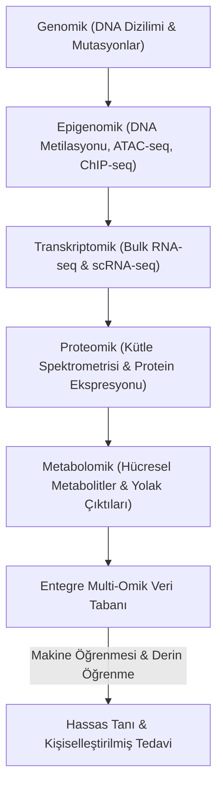

# 💻 Modül 5: Multi-Omik Entegrasyon ve Yapay Zeka (AI) Çağında Akademi

## 1. Islak Laboratuvardan Kuru Laboratuvara: Omik Katmanları

Modern translasyonel tıp, tekil gen/protein incelemelerinden devasa hacimli ve çok boyutlu **Multi-Omik** veri analizlerine evrilmiştir.

---

## 2. "Binlerce Sinyal, Kaç Biyobelirteç?"

> **Oturum III Sunumu (Dr. Öğr. Üyesi Cemil Can EYLEM):**
> *"Kütle spektrometrisi ve yeni nesil dizileme (NGS) ile bir biyopsi örneğinde on binlerce sinyal elde etmek mümkündür. Ancak kritik soru şudur: Bu binlerce sinyalin kaç tanesi gerçek bir biyobelirteçtir ve kliniğe aktarılabilir?"*

### 2.1. Yüksek Boyutluluk Problemi ($p \gg n$)
Omik verilerinde örnek sayısı ($n$, genelde 50-500 hasta), ölçülen değişken/gen sayısından ($p$, 20.000-50.000) çok daha düşüktür. Bu durum aşırı öğrenmeye (overfitting) ve sahte keşiflere yol açar.

### 2.2. Çoklu Hipotez Düzeltmesi (Benjamini-Hochberg FDR)
Binlerce p-değeri hesaplandığında, rastgele şans eseri $\alpha = 0.05$ altında kalan genler ortaya çıkar. Sahte Keşif Oranı (FDR) düzeltmesiyle q-değerleri hesaplanmalıdır:

$$q_{(i)} = \min \left( 1, \min_{k \ge i} \left\{ \frac{m \cdot p_{(k)}}{k} \right\} \right)$$

### 2.3. Makine Öğrenmesi ile Boyut İndirgeme ve Özellik Seçimi
1. **Lasso (L1 Regularization):** Katsayıları sıfıra çekerek yalnızca en güçlü belirteçleri modelde tutar.
2. **Random Forest & Gradient Boosting:** Ağaç tabanlı modellerde Gini önemi (feature importance) ve SHAP (Shapley Additive Explanations) değerleri ile minimal gen panelleri belirlenir.
3. **Çapraz Doğrulama (Cross-Validation):** Overfitting'i önlemek için $k$-fold stratified validation ile ROC-AUC hesaplanır.

---

## 3. Yapay Zekanın Kök Hücre ve Rejeneratif Tıptaki Rolü

* **Hücre Kaderi Tahmini (RNA Velocity & Trajectory Inference):** scRNA-seq verisinde pre-mRNA (spliced vs unspliced) oranları hesaplanarak hücrenin gelecekte hangi yöne farklılaşacağı vektörel olarak tahmin edilir.
* **Kök Hücrelilik İndeksi (mRNAsI):** Malta et al. (2018) tarafından kurulan One-Class Logistic Regression modeli ile tümörün embriyonik kök hücreye ne kadar benzediği puanlanır.
* **Sanal İlaç Taraması (De Novo Molecular Design):** Kanser kök hücre reseptörlerine veya mutant proteinlere bağlanabilecek yeni moleküller üretken yapay zeka (Generative AI) ile tasarlanır.
